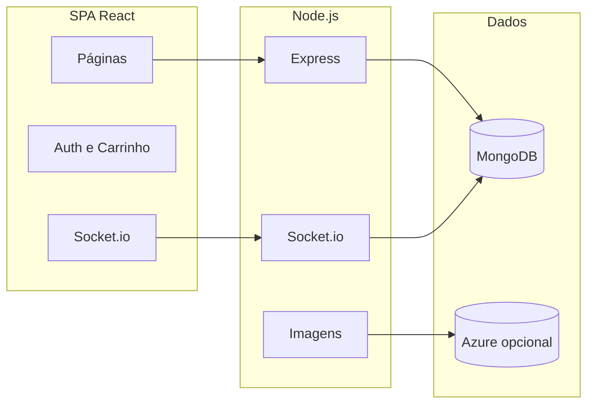

# Do Campo à Mesa

**Trabalho prático individual · Desenvolvimento Web e para a Cloud**  
MEI · ESTG · IPVC  

| | |
|---|---|
| **Unidade curricular** | Desenvolvimento Web e para a Cloud |
| **Docente** | Manuel Carvalho |
| **Aluno(a)** | Rafael Monteiro |
| **N.º** | 27692 |

Mercado digital de produtores do Alto Minho: **catálogo**, **encomendas** e **leilões em tempo real**.  
Stack: **React (Vite)** + **Express** + **MongoDB** + **Socket.io** + **OpenAPI/Swagger**.

> Este ficheiro é o **relatório do trabalho** e o **README do repositório** (documento único). Exportar para PDF para entrega (máx. ~20 páginas; comprimir figuras se necessário).

---

## Índice

1. [Introdução](#1-introdução)  
2. [Objetivos](#2-objetivos)  
3. [Planeamento por etapas](#3-planeamento-por-etapas)  
4. [Semana 1 · Passo 1 — Frontend](#4-semana-1--passo-1--frontend-estático-e-mobile-first)  
5. [Semana 2 · Passo 2 — SPA](#5-semana-2--passo-2--single-page-application)  
6. [Semana 3 · Passos 3 e 4 — API REST e MongoDB](#6-semana-3--passos-3-e-4--api-rest-e-modelo-de-dados)  
7. [Semana 4 · Passos 5 e 6 — Swagger e segurança](#7-semana-4--passos-5-e-6--documentação-e-segurança)  
8. [Semana 5 · Passo 7 — Tempo real](#8-semana-5--passo-7--comunicação-em-tempo-real)  
9. [Semana 6 · Passo 8 — Cloud e imagens](#9-semana-6--passo-8--serviços-cloud-e-imagens)  
10. [Semana 7 — Testes e entrega](#10-semana-7--testes-validação-e-entrega)  
11. [Arquitetura global](#11-arquitetura-global-do-sistema)  
12. [Dificuldades e trabalho futuro](#12-dificuldades-encontradas-e-trabalho-futuro)  
13. [Declaração de ferramentas](#13-declaração-de-uso-de-ferramentas)  
14. [Anexos e arranque do projeto](#14-anexos-e-arranque-do-projeto)

---

## 1. Introdução

O projeto **Do Campo à Mesa** aproxima produtores agrícolas do Alto Minho dos consumidores e da restauração. A plataforma combina **catálogo digital** sazonal, **encomendas online** e **leilões em tempo real** (lotes grossistas).

O trabalho foi desenvolvido em **sete semanas**, seguindo o guião da UC e o código-base fornecido. Cada semana corresponde a **passos** (frontend, SPA, API, dados, documentação, segurança, tempo real, cloud opcional). Os mockups foram orientativos; a solução prioriza correção funcional, consistência dos dados e **Mobile First**.

### Papéis na aplicação

| Papel | Funcionalidades |
|-------|-----------------|
| **Visitante** | Catálogo (filtros), ficha do produtor, leilões, registo, login |
| **Comprador** | Carrinho (1 encomenda/produtor), encomendas, sala de leilão, avaliações |
| **Produtor** | CRUD produtos, imagem, estados de encomenda, criar leilões |
| **Administrador** | Estatísticas, validar produtores, moderar reviews (`/admin`, sem Laravel) |

---

## 2. Objetivos

### 2.1 Objetivo geral

Conceber e implementar uma aplicação web completa — SPA, API REST, MongoDB e tempo real — para visitantes, compradores, produtores e administrador.

### 2.2 Objetivos específicos

| # | Objetivo | Semana |
|---|----------|--------|
| O1 | Bootstrap + SASS, breakpoints 768/1024/1280 | 1 |
| O2 | React, routing, estado global | 2 |
| O3 | API REST (todos os recursos) | 3 |
| O4 | Modelo de dados (embedding, índices) | 3 |
| O5 | OpenAPI + Swagger UI | 4 |
| O6 | JWT, bcrypt, papéis | 4 |
| O7 | Leilões atómicos + notificações | 5 |
| O8 | Imagens (Azure ou local) | 6 |
| O9 | Testes, documentação, vídeo | 7 |

O **deploy PaaS** é facultativo; mantém-se modo local com uploads em disco e compatibilidade Azure via `STORAGE_CONN`.

---

## 3. Planeamento por etapas

| Semana | Passo | Foco | Resultado |
|--------|-------|------|-----------|
| 1 | 1 | SASS, Bootstrap | Tema, grelha catálogo |
| 2 | 2 | React SPA | Rotas, contextos |
| 3 | 3–4 | Express, Mongoose | API + modelos |
| 4 | 5–6 | Swagger, JWT | Docs + auth |
| 5 | 7 | Socket.io | Licitações, sockets |
| 6 | 8 | Storage | Upload imagens |
| 7 | — | QA | Testes, capturas, vídeo |

Testes: `npm run testar`. As figuras do relatório (PDF) mantêm-se localmente em `docs/capturas/` e **não** vão para o Git.

---

## 4. Semana 1 · Passo 1 — Frontend estático e Mobile First

**Enunciado:** identidade visual, Bootstrap 5, SASS Mobile First, breakpoints 768 / 1024 / 1280 px.

**Implementação**

- Parciais SASS: `_variables.scss` (paleta, mapa `$cores-categoria`, breakpoints), `_mixins.scss` (`a-partir-de()`, `cartao`, `grelha`), `_catalogo.scss`, `_leiloes.scss`, `_paineis.scss`, importados em `main.scss`.
- Estilos base pensados para telemóvel; `@include a-partir-de(md|lg|xl)` acrescenta regras para 768 / 1024 / 1280 px. Grelha de produtos: 1 → 2 → 3 → 4 colunas.
- Cores por categoria geradas com `@each` sobre o mapa SASS (classe `cat-fruta`, `cat-mel`, ...).
- HTML semântico e acessibilidade: `header/nav/main/footer`, *skip link* "Saltar para o conteúdo", `aria-live` na sala de leilão e nas notificações, `alt` nas imagens, `prefers-reduced-motion`.
- `CartaoProduto.jsx`: BIO, preço em `pt-PT`, imagem *lazy*, selo ESGOTADO (botão desativado), classificação média.

**Decisão:** grelha customizada para o catálogo em vez de duplicar grelha Bootstrap.

**Evidências**


---

## 5. Semana 2 · Passo 2 — Single Page Application

**Enunciado:** SPA com `react-router-dom`, rotas por papel, estado sessão + carrinho.

**Implementação**

- `App.jsx`: rotas visitante, comprador, produtor, admin; `RotaProtegida.jsx` (redireciona para `/login` guardando a origem).
- Estado global com Context: `AuthContext` (sessão em `localStorage`, revalidada com `GET /auth/eu`), `CarrinhoContext` (agrupado por produtor, persistido), `SocketContext` (uma ligação Socket.io autenticada partilhada por toda a app).
- Hooks: `useApi` (pedido + carregamento + erro + recarregar), `useLeilao` (sala de leilão), `useContagem` (contagem regressiva).
- `Notificacoes.jsx`: *toasts* globais para eventos em tempo real (nova encomenda, mudança de estado, leilão ganho, conta validada).
- Catálogo com pesquisa com *debounce* (300 ms) e filtros categoria, produtor, localidade, época, preço, BIO e ordenação; destaque do leilão ativo com contagem.
- `VITE_USAR_DADOS_SIMULADOS` + `web/src/data/produtos.json` na fase inicial.

**Rotas SPA (mapa completo)**

| Rota | Acesso | Página |
|------|--------|--------|
| `/` | Todos | Catálogo |
| `/produtores/:id` | Todos | Ficha produtor |
| `/leiloes` | Todos | Lista leilões |
| `/login`, `/registo` | Todos | Auth |
| `/carrinho`, `/encomendas` | Comprador | Compra |
| `/leiloes/:id` | Autenticado (só compradores licitam) | Sala de leilão |
| `/produtor`, `/produtor/leiloes/novo` | Produtor | Painel |
| `/admin` | Admin | Moderação |
| `*` | Todos | 404 |

**Evidências**


---

## 6. Semana 3 · Passos 3 e 4 — API REST e modelo de dados

**Enunciado:** recursos REST, Mongoose, embedding vs linking.

### 6.1 Rotas (`api/src/routes/`)

| Ficheiro | Endpoints |
|----------|-----------|
| `auth.js` | `POST /registo` (201), `POST /login`, `GET /eu` |
| `products.js` | `GET` (q, categoria, bio, epoca, localidade, precoMin/Max, ordenacao, produtor), `GET /:id`, `POST` (201 + `Location`), `PUT /:id`, `DELETE /:id` (204), `POST /:id/imagem` |
| `producers.js` | `GET /`, `GET /:id`, `PUT /eu`, `GET /eu/estatisticas` |
| `orders.js` | `POST /` (carrinho completo → uma encomenda por produtor), `GET /`, `GET /:id`, `PATCH /:id/estado` |
| `auctions.js` | `GET` (estado, produtor, terminaAntesDe), `POST`, `GET /:id`, `GET /:id/bids` |
| `reviews.js` | `POST`, `GET`, `POST /:id/denuncia` |
| `admin.js` | `estatisticas`, `servicos`, `utilizadores`, `produtores/pendentes`, `PATCH produtores/:id/validacao`, `reviews/denunciadas`, `PATCH reviews/:id` |

Infra: `app.js`, `server.js`, `middleware/auth.js` (`autenticar`, `exigirPapel`), `middleware/produtorValidado.js`, `middleware/errorHandler.js`, `utils/async.js`, `utils/erro.js`, `services/cicloLeiloes.js`, `services/avaliacoes.js`, `seed/seed.js`.

**Códigos HTTP:** 200, 201 (com `Location`), 204, 400 (validação, com detalhe por campo), 401 (sem token / token inválido), 403 (papel errado ou produtor por validar), 404, 409 (email duplicado, stock insuficiente, estado inválido, avaliação repetida). Os erros 500 nunca expõem detalhes internos.

### 6.2 Modelos

| Modelo | Desenho | Embedding / linking |
|--------|---------|---------------------|
| `User` | Papéis; dados do produtor (`produtor.validado`, `rejeitado`, localidade, coordenadas) e `comprador.tipo` | Dados do produtor **embebidos**: lidos sempre com o utilizador, 1:1 |
| `Product` | Validação (preço > 0, stock ≥ 0, categoria/épocas em lista fechada); `avaliacaoMedia` | **Referência** ao produtor: muitos produtos por produtor, produtor muda independentemente |
| `Order` | Linhas validadas; `total` calculado no servidor; `origem` loja/leilão; `historicoEstados` | Linhas **embebidas** com nome e preço congelados (a encomenda não muda se o produto mudar); comprador/produtor por referência |
| `Auction` | `licitacaoAtual` (valor, comprador, nome, data); `numLicitacoes`; `encomenda` gerada | Licitação atual **embebida** (permite a atualização atómica num só documento) |
| `Bid` | Histórico de licitações | **Coleção separada**: cresce sem limite, não deve inchar o documento do leilão |
| `Review` | Índice único (encomenda, autor); denúncias; `visivel` | **Coleção separada**: moderada e consultada de forma independente |

Índices: `categoria + preco` e `produtor` em `Product`; `papel + produtor.validado` e localidade em `User`; `estado` e `terminaEm` em `Auction` (usados pelo ciclo de abertura/fecho); `comprador` e `produtor` em `Order`; `leilao` em `Bid`; índice único parcial `encomenda + autor` em `Review`.

### 6.3 Regras de negócio

- `POST /orders` recebe o carrinho completo (`{ linhas, entrega }`), agrupa por produtor e devolve a lista de encomendas criadas.
- Stock **reservado atomicamente**: `findOneAndUpdate({ _id, stock: { $gte: qtd } }, { $inc: { stock: -qtd } })`. Se alguma linha falhar, o stock já reservado é reposto e a resposta é 409. Duas compras simultâneas da última unidade nunca são ambas aceites.
- Estados `pendente → confirmada → pronta → entregue` só avançam (atualização condicionada ao estado anterior; recuar → 409). O produtor só altera as suas encomendas.
- Avaliação só depois de `entregue`, uma por encomenda; a média do produto é recalculada com `aggregate` (ignora avaliações ocultas pelo admin).
- Produtor só publica produtos e leilões depois de validado pelo administrador.
- Pesquisa textual com `$regex` escapado (evita injeção de expressões regulares); campos aceites em `POST/PUT` são filtrados (proteção contra *mass assignment*).

### 6.4 Frontend ligado à API

`Catalogo` (filtros API), `Carrinho`, `Encomendas`, `produtor/Painel` (CRUD + upload de imagem), `NovoLeilao`, `admin/Painel`. Ficha pública: mapa OSM e denúncia de avaliações.

**Evidências**


---

## 7. Semana 4 · Passos 5 e 6 — Documentação e segurança

**Enunciado:** OpenAPI; bcrypt + JWT + autorização.

- `api/openapi.yaml` (OpenAPI 3, validado com Redocly): todos os endpoints, `components/schemas` reutilizados por `$ref`, respostas de erro comuns, esquema `bearerAuth` → **`http://localhost:3000/api-docs`** (botão *Authorize* para testar rotas protegidas).
- Registo: bcrypt (12 rondas); não é possível registar administradores; produtor `validado: false` até o admin aprovar; login com mensagem única para email ou password errados.
- JWT `{ id, papel, nome }` com validade de 2 h; `web/src/api/client.js` envia `Authorization: Bearer`; um 401 termina a sessão no cliente.
- Autorização no servidor em todas as rotas (`exigirPapel`, `produtorValidado`, verificação de dono do recurso); o frontend apenas esconde opções.
- Em produção: redirecionamento para HTTPS, `trust proxy`, CORS limitado a `CLIENT_URL`, `JWT_SECRET` obrigatório.
- Admin no mesmo React (`/admin`): estatísticas, validar/rejeitar produtores, ocultar/repor avaliações denunciadas, leilões ao vivo, estado dos serviços.

**Evidências**


---

## 8. Semana 5 · Passo 7 — Comunicação em tempo real

**Servidor:** `sockets/index.js` autentica o *handshake* com JWT e junta cada ligação às salas `user:ID` (e `admins`); `sockets/leiloes.js` gere as salas `leilao:ID`; `services/cicloLeiloes.js` abre e fecha leilões a cada 2 s.

**Cliente:** `SocketContext.jsx` + `Notificacoes.jsx` (notificações globais), `useLeilao.js` (estado da sala, desvio do relógio, `licitar` com confirmação), `SalaLeilao.jsx` (botões +5/+10/+25 €, contagem sincronizada com o servidor, indicação "está a ganhar", resultado final).

| Evento | Sentido | Sala | Conteúdo |
|--------|---------|------|----------|
| `entrar` / `sair` | cliente → servidor | — | id do leilão |
| `estado` | servidor → cliente | o próprio | `{ agora, leilao, licitacoes }` (o `agora` permite corrigir o relógio local) |
| `licitar` | cliente → servidor (com *ack*) | — | `{ leilaoId, valor }` → `{ ok, erro? }` |
| `nova-licitacao` | servidor → todos | `leilao:ID` | valor, nome, data, n.º de licitações |
| `recusada` | servidor → cliente | o próprio | motivo (valor baixo, leilão fechado, papel) |
| `presenca` | servidor → todos | `leilao:ID` | n.º de pessoas na sala |
| `aberto` / `terminado` | servidor → todos | `leilao:ID` | estado e vencedor |
| `leilao-ganho` | servidor → vencedor | `user:ID` | leilão e encomenda criada |
| `nova-encomenda` | servidor → produtor | `user:ID` | encomenda recebida |
| `encomenda-atualizada` | servidor → comprador e produtor | `user:ID` | `{ id, estado }` |
| `conta-validada` / `conta-rejeitada` | servidor → produtor | `user:ID` | decisão do admin |
| `leilao-atualizado` | servidor → admins | `admins` | resumo para o painel ao vivo |

**Consistência das licitações:** a licitação é aceite com uma única operação atómica:

```js
Auction.findOneAndUpdate(
  { _id, estado: 'ativo', terminaEm: { $gt: agora }, 'licitacaoAtual.valor': { $lte: valor - incremento } },
  { $set: { licitacaoAtual: { valor, comprador, nome, em } }, $inc: { numLicitacoes: 1 } },
  { new: true })
```

Se duas licitações iguais chegarem ao mesmo tempo, só a primeira satisfaz a condição; a segunda recebe `recusada`. O fecho do leilão também é condicionado ao estado `ativo`, por isso só um processo o fecha. O vencedor recebe uma encomenda confirmada (`origem: 'leilao'`). O teste automático envia licitações simultâneas e confirma que só uma é aceite.

**Evidências**


---

## 9. Semana 6 · Passo 8 — Serviços Cloud e imagens

- `api/src/services/imagens.js`: aceita só JPEG/PNG/WebP até 2 MB; a extensão vem do tipo MIME e o nome é gerado (`data-uuid.ext`), nunca o nome enviado pelo utilizador.
- `STORAGE_CONN` → Azure Blob Storage; sem ela, `api/uploads/` servido em `/uploads` (desenvolvimento).
- `POST /api/products/:id/imagem` (multer, só o dono do produto).

**Escolha do modelo de serviço**

| Componente | Serviço | Modelo | Justificação |
|------------|---------|--------|--------------|
| API + Socket.io | Azure App Service (Linux, Node 20, WebSockets ligados) | PaaS | Sem gestão de SO; HTTPS e escala incluídos; suporta ligações persistentes |
| SPA | Azure Static Web Apps | PaaS | Ficheiros estáticos em CDN; `staticwebapp.config.json` encaminha rotas da SPA para `index.html` |
| Base de dados | MongoDB Atlas | DBaaS | Réplicas e backups geridos |
| Imagens | Azure Blob Storage | PaaS (armazenamento) | Ficheiros fora do servidor, sobrevivem a reinícios e escalam |

Uma VM (IaaS) obrigaria a gerir SO, atualizações e certificados sem benefício para este caso; um BaaS (ex.: Firebase) não permitiria a lógica de servidor própria (leilões atómicos, validações).

`scripts/deploy-azure.sh` cria os recursos com a Azure CLI e publica API e SPA; `web/.env.production.example` indica as variáveis do build. URLs públicos: *(preencher após o deploy)*.

---

## 10. Semana 7 — Testes, validação e entrega

| Cenário | Resultado esperado |
|---------|-------------------|
| Visitante | Catálogo, produtor |
| Comprador | Login → carrinho → encomenda → leilão |
| Produtor | Estados encomenda, leilão |
| Admin | Validar / moderar |

**Automatizado:**

- `cd api && npm test`: 60 testes da API e do Socket.io (MongoDB em memória; ou `API_URL=...` contra um servidor real). Cobre registo/login, filtros, códigos HTTP, stock atómico, estados das encomendas, avaliações, moderação, ciclo de vida dos leilões e licitações simultâneas. Resultado: **60 / 60**.
- `npm run testar` (raiz): 43 verificações REST + E2E Playwright na SPA + socket. Resultado: **43 / 43**.

**Entregáveis:** código Git; **este README em PDF**; vídeo (Anexo B); capa preenchida.

---

## 11. Arquitetura global do sistema



**Compra:** o comprador autenticado confirma o carrinho com um único `POST /orders`; a API reserva o stock e cria uma encomenda por produtor; cada produtor é notificado (`nova-encomenda`) e avança os estados; o comprador vê as mudanças em tempo real e pode avaliar quando a encomenda é `entregue`.

**Leilão:** o produtor validado cria o leilão (imediato ou agendado); o ciclo do servidor abre-o à hora marcada; os compradores licitam na sala Socket.io (atualização atómica + registo em `Bid`); no fim, o vencedor é notificado e recebe uma encomenda.

---

## 12. Dificuldades encontradas e trabalho futuro

- Transações MongoDB exigem réplica set → substituídas por operações atómicas condicionadas (reserva de stock com reposição em caso de falha), que funcionam em qualquer MongoDB.
- Relógio do cliente diferente do servidor → o servidor envia `agora` e a contagem usa o desvio calculado.
- Leilões que terminavam sem ninguém ligado → fecho feito por um ciclo no servidor, independente dos sockets.
- Carrinho perdia estado no refresh → `localStorage`.
- Produtor não validado → aviso no painel e 403 na API.

Futuro: backoffice Laravel (bónus facultativo), paginação no catálogo, pagamentos.

---

## 13. Declaração de uso de ferramentas

| Ferramenta | Uso |
|------------|-----|
| React, Vite, react-router-dom | SPA |
| Bootstrap 5, SASS | UI |
| Express, Mongoose, bcryptjs, JWT | API |
| Socket.io | Tempo real |
| multer, @azure/storage-blob | Imagens |
| swagger-ui-express | OpenAPI |
| MongoDB / Atlas / memória | BD |
| Playwright | Capturas e testes |
| Cursor (IA) | Implementação e documentação |

O aluno declara compreender o código entregue.

---

## 14. Anexos e arranque do projeto

### Anexo A — URLs locais

| Serviço | URL |
|---------|-----|
| SPA | http://localhost:5173 |
| API | http://localhost:3000 |
| Swagger | http://localhost:3000/api-docs |
| Health | http://localhost:3000/api/health |

### Anexo B — Vídeo

*(Inserir ligação YouTube, Drive ou Moodle.)*

### Anexo C — Figuras (local / PDF de entrega; não versionadas no Git)

| Ficheiro | Figura |
|----------|--------|
| `01-semana1-catalogo-desktop.png` | 1 |
| `02-semana1-catalogo-mobile.png` | 2 |
| `03`–`05`, `10` | 3–6 |
| `07`, `11` | 7–8 |
| `06`, `12`, `13` | 9–11 |
| `08`, `09` | 12–13 |

### Estrutura do repositório

```
do-campo-a-mesa/
├── README.md              # Este relatório
├── api/
│   ├── openapi.yaml       # Documentação OpenAPI
│   ├── src/               # app, server, models, routes, middleware, services, sockets, seed
│   └── test/e2e.js        # npm test
├── web/
│   ├── public/staticwebapp.config.json
│   └── src/               # api, components, context, hooks, pages, styles
├── scripts/testar-tudo.mjs, deploy-azure.sh
└── package.json
```

### Arranque

```bash
# API (com MongoDB)
cd api && cp .env.example .env && npm install && npm run seed && npm run dev

# API sem MongoDB local
cd api && npm run dev:memoria

# SPA
cd web && cp .env.example .env && npm install && npm run dev
```

**Seed:** password `password123` — admin `admin@exemplo.pt`; produtores `horta@`, `mel@`, `quinta@` (validados) e `queijaria@` (por validar); compradores `tasca@` (restaurante) e `ana@` (todos `@exemplo.pt`). Inclui um leilão ativo e um agendado.

### Verificação

- `cd api && npm test` — testes da API e Socket.io  
- `npm run testar` — vistoria completa  

### Regras Git

- Commits claros por etapa; nunca `.env` no repositório.

---

*Fim do relatório / README.*
